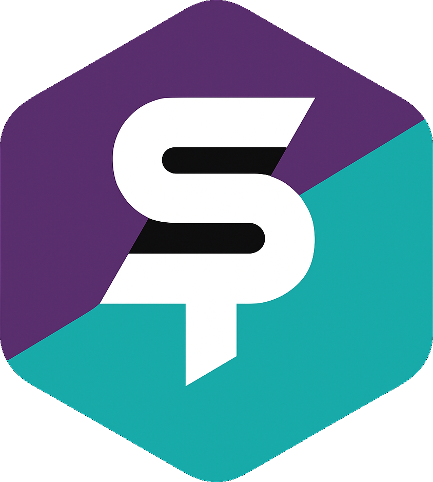

# Slamhaus

<div align="center">
  <a href="https://www.slamhaus.com">
    
  </a>
</div>

Slamhaus is a C++17 command-line static-site compiler for game developers. It
turns GitHub Flavored Markdown into static HTML and connects typed C++ to the
browser through WebAssembly without handwritten JavaScript.

## Install

Download a `v0.1.0` binary from GitHub Releases, or build locally:

```sh
cmake -S . -B build -DCMAKE_BUILD_TYPE=Release
cmake --build build --parallel
cmake --install build --prefix "$HOME/.local"
slamhaus --version
```

The package contains the CLI and `<slam/slam.hpp>` for C++ IDE indexing.
Slamhaus can install its pinned Emscripten toolchain when a project needs C++.

## First site

```sh
slamhaus init my-site
cd my-site
slamhaus check --strict
slamhaus build
slamhaus serve
```

`init` creates a blank universal project:

```text
my-site/
  slamhaus.yaml
  AGENTS.md
  pages/
    index.slam
  partials/
    footer.md
```

Optional `partials/`, `assets/`, and `code/` directories are added only when
needed. Generated files go to `dist/`.

The repository's GitHub Pages deployment publishes the committed `dist/`
directory. Regenerate it locally with `scripts/build-pages.sh`; the script
uses the ignored `.emscripten_cache/` directory and rewrites local URLs for a
GitHub Pages project path.

- `.md` is portable GFM with optional YAML front matter.
- `.slam` adds `slam-ui` and one optional executable `cpp wasm` fence.
- Files in `partials/` use the same `.md` and `.slam` formats.

## Typed interaction

````markdown
```slam-ui
Number Left("Left") { value = 2; }
Number Right("Right") { value = 3; }
Button Calculate("Add") { on Click => Add(Left, Right) -> Result; }
Output Result("Ready");
```

```cpp wasm
auto Add(int32 A, int32 B) -> int32 {
  return A + B;
}
```
````

Slamhaus generates accessible HTML, DOM identifiers, event bindings, the page
module, typed exports, and the browser bootstrap. Static pages contain no
JavaScript. Interactive pages load one generated external runtime.

Normal `cpp`, `csharp`, and `python` fences are displayed and highlighted at
build time through Tree-sitter. Only the exact `cpp wasm` marker executes.

## Applications

Canvas applications use an Unreal-familiar lifecycle without claiming Unreal
Engine compatibility:

```yaml
---
title: Game
runtime:
  application: FGame
  canvas: Game
---
```

````markdown
```slam-ui
Canvas Game() {
  width = 1280;
  height = 720;
  responsive = true;
};
```

```cpp wasm
class FGame final : public FApplication {
public:
  void BeginPlay() override;
  void Tick(float DeltaTime) override;
  void EndPlay() override;
};
```
````

The SDK provides input, touch, gamepads, display state, DOM updates, audio,
HTTP, storage, navigation, clipboard, haptics, sensors, accessibility, logging,
and PWA installation helpers. Rendering remains the responsibility of WebGL,
SDL, GLFW, or the user's engine.

## Examples

Examples are baked into the binary and are separate from blank initialization:

```sh
slamhaus examples static-site --profile minimal
slamhaus examples wasm-site --profile complete
```

`minimal` is a portable non-WASM documentation site. `complete` demonstrates
typed interaction, embedded C++, generated modules, mobile behavior, and PWA
output. Install Emscripten before building the complete profile:

```sh
slamhaus toolchain install
slamhaus build wasm-site
```

## Commands

```text
slamhaus init [directory] [--force]
slamhaus examples [directory] [--profile minimal|complete] [--force]
slamhaus build [project] [-o directory] [--no-wasm] [--strict] [--dry-run]
slamhaus check [project|file] [--strict] [--format text|json]
slamhaus fmt [project|file ...] [--check]
slamhaus watch [project] [-o directory] [--no-wasm] [--strict]
slamhaus serve [project] [-p port] [--host address] [--no-wasm]
slamhaus toolchain <status|install|path|remove> [--format json]
slamhaus doctor [project] [--format text|json]
slamhaus explain <diagnostic-code>
slamhaus language-schema
slamhaus completion <bash|zsh|fish>
slamhaus lsp
```

The editor-neutral LSP provides diagnostics, completions, hover, symbols,
formatting, and semantic tokens across Markdown, Slam UI, and embedded C++.
Slamhaus does not ship an editor-specific extension.

## Browser and language roadmap

The compiler has a filesystem-free workspace API so the same parsing,
validation, and rendering stages can later run in a browser against local
files. Behavior adapters use a language-neutral module manifest. C++ is the
only executable adapter in `0.1.0`; `csharp wasm` and `python wasm` are reserved
for future Unity- and scripting-oriented adapters.

See the [documentation homepage](docs/index.md),
[language reference](docs/syntax-reference.md),
[project configuration](docs/project-configuration.md),
[C++ SDK reference](docs/cpp-sdk.md), [deployment guide](docs/deployment.md),
and [PWA guide](docs/pwa.md).

## Development

```sh
cmake -S . -B build -DBUILD_TESTING=ON
cmake --build build --parallel
ctest --test-dir build --output-on-failure
./build/slamhaus check . --strict
./build/slamhaus fmt . --check
```

To regenerate the deployable site:

```sh
./scripts/build-pages.sh
```

Architecture and contribution constraints are recorded in [AGENTS.md](AGENTS.md).
The version has one source of truth in [VERSION](VERSION). Slamhaus is MIT
licensed.
